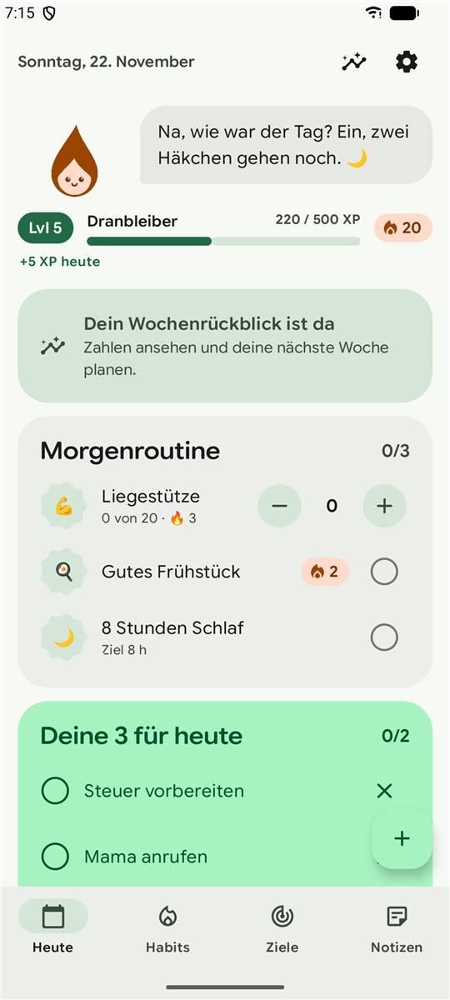
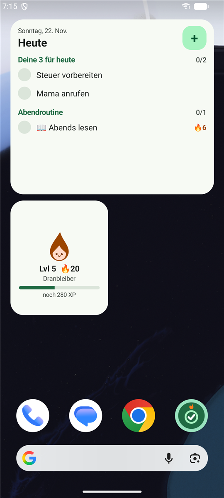
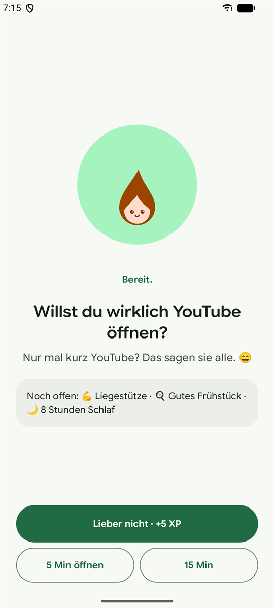
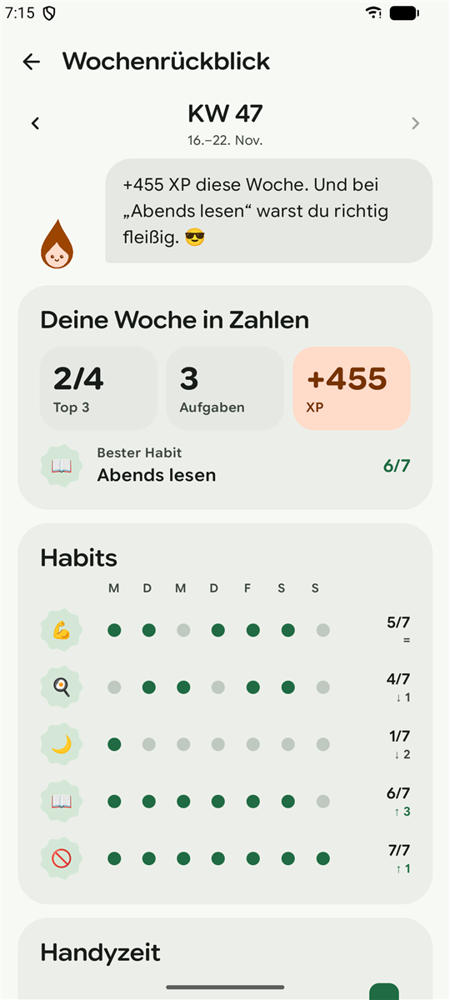
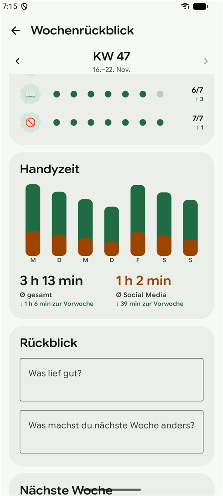
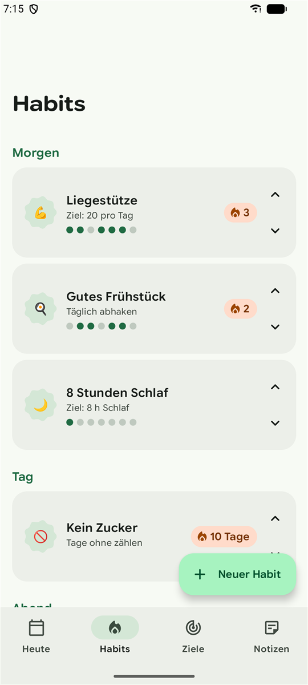
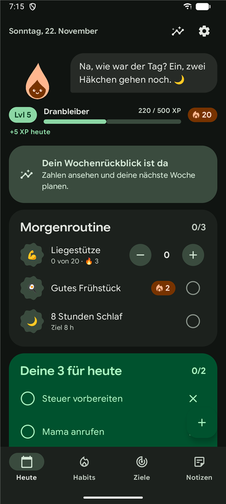

# Fokus – Download

**Aufgaben, Habits und Handyzeit an einem Ort.** Android-App, ohne Konto, ohne Internet.

  
  
  

  
  
  
  

## ⬇️ Neueste Version laden

**[Fokus.apk herunterladen](https://github.com/sumoSven/Fokus-Download/releases/latest/download/Fokus.apk)** · aktuell **v0.2.1**

Den Link am besten direkt auf dem Handy öffnen. Läuft ab Android 8.

## Installieren

1. `Fokus.apk` auf dem Handy öffnen.
2. Android fragt, ob „unbekannte Apps“ installiert werden dürfen → einmal erlauben.
   Google Play Protect warnt eventuell, weil die App nicht aus dem Play Store kommt → „Trotzdem installieren“.
3. Fokus öffnen, deinen Begleiter wählen und festlegen, welche Habits du jeden Tag schaffen willst.

**Update:** Einfach die neue `Fokus.apk` über denselben Link installieren – deine Daten bleiben.

## Einrichten (einmalig, je 1 Minute)

| Was | So geht's |
|---|---|
| **Handyzeit messen** | In Fokus auf „Heute“ bei *Handyzeit* auf **Zugriff erlauben** → in der Liste **Fokus** antippen → **Nutzungsdatenzugriff zulassen** einschalten. |
| **Widgets auf den Startbildschirm** | *Einstellungen → Widgets* → **Heute** und/oder **Begleiter** antippen → **Hinzufügen**. (Oder lange auf den Startbildschirm drücken → Widgets → Fokus.) |
| **Pause vor Social Media** *(optional)* | *Einstellungen → Pause vor Social Media* → **Bedienungshilfe einschalten** → „Fokus – Pause vor Social Media“ antippen und einschalten. Android zeigt dabei eine deutliche Warnung – das ist bei jeder Bedienungshilfe so. **Schalter grau?** Dann in Fokus auf **App-Info öffnen** → oben rechts **⋮** → **„Eingeschränkte Einstellungen zulassen“** und es noch einmal versuchen. |

## Was die App kann

- **Heute:** Morgenroutine, „Deine 3 für heute“, Aufgaben, Handyzeit und Abendroutine auf einem Bildschirm.
  Das **+** hält schnell eine Aufgabe, eine Top-3 oder eine Notiz fest.
- **Habits mit Streak-Flamme 🔥:** abhaken, zählen (z. B. 20 Liegestütze), Schlaf eintragen,
  etwas vermeiden (zählt die starken Tage), Handyzeit- und Social-Media-Limit (automatisch gemessen).
- **Dein Begleiter:** Funke, Keimling oder Fuchs wächst mit deinem Level, hat Launen und
  redet frech, als Coach oder ruhig – wie du willst. XP fürs Abhaken, Konfetti für perfekte Tage.
- **Handyzeit** gesamt und **extra Social Media** (Instagram, TikTok, YouTube & Co.).
- **Pause vor Social Media:** Bevor Instagram & Co. aufgehen, kommt ein Atemzug und die Frage
  „Willst du wirklich?“ – „Lieber nicht“ bringt XP, „5 Min“ oder „15 Min“ lässt dich rein.
- **Zwei Widgets:** *Heute* – Top 3 und die Routine der Tageszeit direkt abhaken.
  *Begleiter* – Figur, Level und Streak auf einen Blick.
- **Wochenrückblick am Sonntag:** Top 3, XP, bester Habit, jeder Habit im Vergleich zur Vorwoche,
  Handyzeit als Balken – dazu „Was lief gut?“ und bis zu 3 Ziele für die nächste Woche.
- **Ziele** mit Schritten, **Notizen** als Inbox, **Erinnerungen** (morgens, abends, pro Habit mit
  „Erledigt ✓“-Knopf, sonntags für den Rückblick), **Backup** als Datei.

## Datenschutz

Fokus hat **keine Internet-Berechtigung** – technisch kann die App nichts verschicken.
Aufgaben, Habits, Handyzeit und Notizen bleiben auf deinem Handy.
Die Bedienungshilfe für die Pause sieht nur, **welche App** nach vorne kommt – keine Inhalte, keine Texte.

## Neu in v0.2.1

- 🛡️ „Widerstanden“: Auf *Heute* siehst du, wie oft du am Pause-Bildschirm „Lieber nicht“ gewählt hast –
  im Wochenrückblick mit Vergleich zur Vorwoche.

## Neu in v0.2.0

- Zwei Widgets für den Startbildschirm
- Wochenrückblick mit Handyzeit-Verlauf, Reflexion und Wochenzielen
- Begleiter mit Level, XP und Sprüchen in drei Tonfällen
- Erinnerung pro Habit mit „Erledigt ✓“ und „In 15 Min“ direkt in der Benachrichtigung
- Pause vor Social Media
